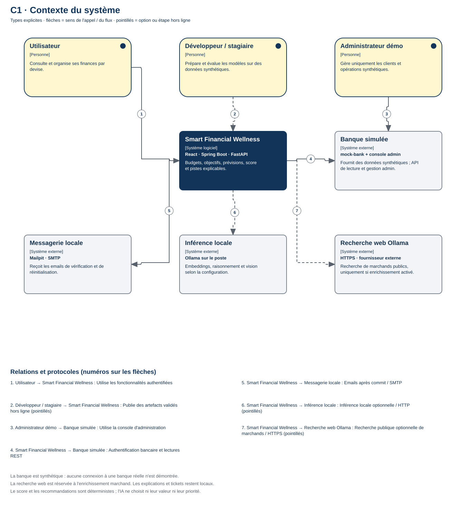
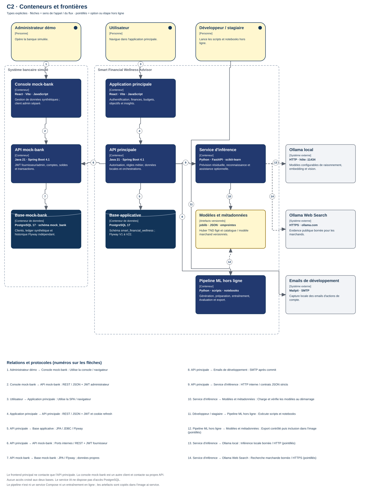

# Architecture actuelle — Smart Financial Wellness Advisor

Cette vue décrit les composants exécutables de la version actuelle du dépôt,
qui comprend une application financière
principale, un fournisseur bancaire synthétique indépendant, un service d'inférence
et un pipeline ML hors ligne. La disponibilité des fonctions IA dépend de la
configuration et des modèles installés.

## Diagrammes C4

Le modèle canonique est dans [c4/README.md](c4/README.md).
Le workspace natif [c4/workspace.dsl](c4/workspace.dsl) est chargé par le
conteneur `sfwa-structurizr`. Ouvrir **[http://localhost:8085](http://localhost:8085)**,
puis **Diagrams**, pour parcourir ses dix vues. Les commandes de démarrage et
de validation sont dans le guide C4. L'ancien export HTML/SVG est conservé
comme référence hors ligne ; il n'est pas synchronisé automatiquement avec le DSL.

```powershell
Invoke-Item .\docs\architecture\c4\index.html
```

### C1 — Contexte



### C2 — Conteneurs



Les vues C3 séparées couvrent le backend données, le backend insights, la SPA
principale, FastAPI, le mock-bank et le pipeline ML. La dernière vue montre le
déploiement local Compose et Ollama sur le poste.

## Applications et responsabilités

| Élément | Responsabilités actuelles | Évidence principale |
| --- | --- | --- |
| Frontend principal | Authentification, Dashboard, transactions et revue, catégories, banque, CSV/ticket, budgets, Goals, Forecast, score et recommandations | [Routes React](../../frontend/src/App.jsx), [client authentifié](../../frontend/src/services/apiClient.js) |
| Backend principal | Autorisation, ownership, données locales, règles financières et orchestrations HTTP | [packages backend](../../backend/src/main/java/com/azizx25/smartfinancialwellness), [sécurité](../../backend/src/main/java/com/azizx25/smartfinancialwellness/config/SecurityConfiguration.java) |
| PostgreSQL applicatif | Comptes, transactions, imports, profils, plans, objectifs, snapshots, facteurs et justifications | [Flyway V1–V22](../../backend/src/main/resources/db/migration), [configuration](../../backend/src/main/resources/application.properties) |
| Mock-bank | Identités synthétiques, JWT client/admin, lectures de comptes/ledger et administration | [API mock-bank](../../mock-bank/src/main/java/com/azizx25/mockbank) |
| Console mock-bank-ui | Gestion authentifiée de la banque synthétique, séparée de la SPA principale | [routes admin](../../mock-bank-ui/src/App.jsx) |
| PostgreSQL mock-bank | Ledger synthétique et historique Flyway indépendant | [migrations V1–V4](../../mock-bank/src/main/resources/db/migration) |
| FastAPI | Résidu Forecast, reconnaissance marchande, explications et extraction de ticket optionnelles | [application FastAPI](../../ai-service/src/forecast_ai/main.py) |
| Pipeline ML | Données synthétiques, features, splits temporels, entraînement, évaluation et export contrôlé | [scripts](../../ml-pipeline/scripts), [modules ML](../../ml-pipeline/src), [expérience Forecast](forecast-ml.md) |
| Ollama | Service sur le poste pour embeddings, raisonnement et vision configurables | [providers](../../ai-service/src/forecast_ai/ollama_providers.py), [assistance](../../ai-service/src/forecast_ai/assistance.py) |
| Mailpit | Capture SMTP locale des emails de compte envoyés après commit | [dispatcher](../../backend/src/main/java/com/azizx25/smartfinancialwellness/email/AfterCommitEmailDispatcher.java), [Compose](../../compose.yaml) |

## Frontières et règles représentées

La SPA principale appelle uniquement le backend. La console mock-bank-ui est
une autre application, qui appelle l'API d'administration de son simulateur.
Aucune SPA n'accède directement aux bases, au service IA ou à Ollama.

Le backend est un monolithe modulaire : ses packages par fonctionnalité ne sont
pas des microservices. L'utilisateur vient du principal JWT et l'identité / le
statut du compte sont relus en PostgreSQL. Les comptes non vérifiés ont un accès
limité ; les API financières exigent un utilisateur et une identité ACTIVE.

La connexion bancaire repose sur un login synthétique et un JWT fournisseur
court. Le backend retrouve le client fournisseur depuis la connexion détenue
par le principal. Les API publiques ne demandent pas un customerId arbitraire.
Les tables de conception OAuth ne constituent pas un flux Authorization Code /
PKCE implémenté ; ce flux n'est pas dessiné comme actif.

La synchronisation reste déclenchée par l'utilisateur. Les appels fournisseur
précèdent l'écriture applicative atomique et idempotente. L'historique local est
conservé après déconnexion. L'import CSV possède son propre workflow de
prévisualisation, confirmation de mapping et idempotence.

Les dépenses réelles proviennent de la catégorie actuelle de la transaction,
avec filtrage de propriétaire, mois et devise et exclusion des transactions
bancaires non POSTED et des transferts internes confirmés. Une suggestion IA
reste PENDING jusqu'à sa revue. Le choix manuel, les règles et la mémoire privée
gardent leur priorité ; aucune affectation ML automatique n'est représentée.

Salary Planning produit les revenus, budgets et capacité d'épargne mensuelle.
Goals lit la capacité persistée de MonthlyPlan pour les allocations, mais seuls
les montants initiaux et les contributions déterminent l'épargne réelle.
Forecast traite la fin du mois, avec une base déterministe et un résidu Huber
synthétique TND éligible. Les simulations Goals/Forecast restent temporaires.

Le score est déterministe et stocké dans des snapshots immuables. Les
recommandations utilisent les facteurs disponibles de ces évaluations ; leurs
justifications et feedback sont persistés. Un LLM peut expliquer une règle
contrôlée, mais ne choisit ni score, priorité, montant ni action financière.

Le service IA ne possède pas d'accès PostgreSQL. Forecast utilise des features
agrégées ; la reconnaissance reçoit une clé opaque, du texte marchand assaini
et les versions attendues, sans montant ni identifiant SQL. L'enrichissement
marchand peut appeler une recherche web externe. Les explications et tickets
utilisent uniquement l'inférence locale. Les tickets sont éphémères, revus
humainement, puis exportés en CSV ; l'extraction ne crée aucune transaction.

Les modèles sont entraînés séparément et exportés avec leurs métadonnées.
L'image ai-service inclut les artefacts : aucun entraînement n'est déclenché
pendant une requête. Le backend conserve ses réponses déterministes / sûres
lorsque l'IA est désactivée, indisponible ou invalide.

Chaque Spring Boot possède son schéma, ses migrations et sa base. Flyway est
le mécanisme de gestion du schéma ; Hibernate utilise ddl-auto=validate.
Les montants utilisent des décimaux et les devises ne sont ni combinées ni converties.

## Portée locale et fonctionnalités optionnelles

[compose.yaml](../../compose.yaml) fournit les deux PostgreSQL, les deux API Java,
FastAPI, les deux serveurs Nginx et Mailpit. Ollama et le pipeline ML sont sur
le poste, hors Compose. Les ports hôte sont configurables ; la session utilise
le backend publié sur 8082, tandis que le port interne reste 8080.

La fixture superviseur est synthétique et idempotente, avec mutations mock-bank
restreintes au profil demo, au flag explicite et à un administrateur.
Les options d'enrichissement, d'explication locale et de vision sont désactivées
par défaut dans la configuration d'exemple.

Les commandes d'export/suppression de données et certains choix de consentement
du profil restent des éléments de prototype. La vue ne revendique ni ces
workflows comme implémentés, ni une connexion bancaire réelle, ni une release
de production.

## Guides de fonctionnalité

- [Authentification et profil](../api/authentication-profile.md)
- [Connexion et synchronisation mock-bank](../api/mock-bank-connection.md)
- [CSV import](../api/csv-import.md)
- [Catégories et reconnaissance marchande](../api/transaction-categories.md)
- [Forecast](../api/forecast.md) et [expérience ML](forecast-ml.md)
- [Financial Wellness Score](../api/financial-wellness-score.md)
- [Recommandations](../api/recommendations.md)
- [Assistance locale et tickets](../api/local-assistance.md)
- [Démonstration superviseur](../demo/supervisor-demo.md)

Modifier [c4/workspace.dsl](c4/workspace.dsl), valider avec Structurizr,
puis recharger le viewer local pour actualiser les vues natives.
