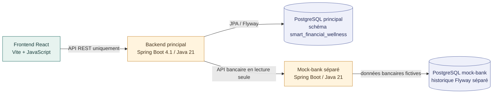

# Vue d'architecture démontrable

La plateforme principale et le fournisseur bancaire simulé restent deux
systèmes séparés. Le frontend ne contacte que le backend principal ; il ne lit
jamais directement une base de données et n'appelle jamais le mock-bank.

## Frontières de responsabilité

- Le frontend présente l'expérience utilisateur et remplacera progressivement
  ses fixtures par des appels au backend principal.
- Le backend porte les règles de bien-être financier et orchestre les accès à
  PostgreSQL, au mock-bank et, plus tard, au service d'inférence.
- Le mock-bank simule uniquement un fournisseur bancaire externe en lecture
  seule. Il ne contient aucune règle métier de bien-être financier.
- Les deux applications Spring Boot ont leurs propres données, leurs propres
  migrations Flyway et aucune clé étrangère entre leurs bases.

La page « Banque Démo » du prototype reste une maquette visuelle et ne réalise
aucun appel au mock-bank. Le flux de connexion décrit ci-dessous est exposé par
le backend, sans modification du frontend dans cet incrément.

## État actuel du mock-bank

Le dossier `mock-bank/` contient une application Java 21 / Spring Boot 4.1
indépendante. Elle utilise sa propre base PostgreSQL, le schéma `mock_bank` et
un historique Flyway distinct de celui du backend principal. Toutes ses données
sont synthétiques.

La fondation actuelle fournit les mappings JPA, repositories et services
internes de lecture pour les clients, comptes, soldes et transactions. Elle
expose `GET /actuator/health` ainsi que quatre routes bancaires en lecture seule :

- `GET /api/v1/customers/{customerId}/accounts` retourne les métadonnées
  publiques dans un ordre déterministe ;
- `GET /api/v1/customers/{customerId}/accounts/{accountId}` retourne les
  métadonnées publiques d'un compte appartenant au client ;
- `GET /api/v1/customers/{customerId}/accounts/{accountId}/balance` retourne
  uniquement le contrat de solde ;
- `GET /api/v1/customers/{customerId}/accounts/{accountId}/transactions`
  retourne une enveloppe paginée de transactions du compte.

La route de transactions filtre la `bookingDate` avec des bornes ISO-8601
`from` et `to` inclusives. Elle trie par date décroissante puis par identifiant
de transaction externe décroissant. `page` commence à `0` et vaut `0` par
défaut ; `size` vaut `20` par défaut et accepte les valeurs de `1` à `100`.
L'enveloppe stable contient uniquement `items`, `page`, `size`,
`totalElements`, `totalPages`, `first` et `last`.

Les entités JPA, UUID internes et soldes ne sont pas exposés par les routes de
métadonnées. Un client inconnu, un compte inconnu ou un compte appartenant à
un autre client produit un JSON `404`; le dernier cas utilise toujours
`Account not found` afin d'empêcher l'énumération des comptes.

`POST /api/auth/login` valide les identifiants bancaires de démonstration avec
BCrypt et émet un JWT de courte durée. Les routes de données exigent ce bearer,
valident sa signature, son expiration, son issuer et son audience, puis
vérifient que son sujet correspond au client du chemin. Les API OAuth, écran de
consentement, refresh token, paiement et virement ne sont pas implémentées.

## Adaptateur interne du backend principal

Le backend principal dispose d'un port d'authentification mock-bank et du port
applicatif `ReadOnlyBankDataPort`, implémentés par un adaptateur HTTP synchrone
fondé sur `RestClient`. Il couvre le login fournisseur et les quatre lectures :
liste des comptes, métadonnées d'un compte, solde et page de transactions. Ses
résultats sont des records immuables appartenant au backend ; les DTO HTTP du
fournisseur restent confinés dans le package d'infrastructure et aucune classe
Java du mock-bank n'est importée.

L'adaptateur encode chaque identifiant comme un segment de chemin, ajoute le
bearer fournisseur uniquement au moment de l'appel, transmet explicitement la
pagination, et omet `from` ou `to` lorsqu'ils sont absents.
Les montants restent des `BigDecimal`, les dates de transaction des
`LocalDate`, et les valeurs assimilables à des énumérations restent des chaînes
afin d'éviter un couplage de code entre applications. Son décodeur JSON accepte
les champs amont ajoutés ultérieurement sans relâcher la validation Jackson
globale du backend.

La configuration utilise `MOCK_BANK_BASE_URL` (défaut local
`http://localhost:8081`), `MOCK_BANK_CONNECT_TIMEOUT` (défaut `2s`) et
`MOCK_BANK_READ_TIMEOUT` (défaut `5s`). Dans Compose, le backend reçoit
`http://mock-bank:8081`. Une URL non HTTP(S), relative ou contenant des
identifiants, une requête ou un fragment, ainsi qu'un délai non positif,
empêche le démarrage.

Les erreurs sont séparées entre requête locale invalide, `404` amont, requête
rejetée, indisponibilité réseau/serveur et violation du contrat de réponse.
Seuls `Customer not found` et `Account not found` peuvent être repris depuis
un corps `404`; aucun corps brut n'est propagé, aucun retry automatique n'est
effectué et les données bancaires ne sont pas journalisées.

Les contrôleurs publics sont strictement centrés sur l'utilisateur courant :
ils n'acceptent ni `userId` applicatif ni `customerId` fournisseur. Le backend
dérive l'utilisateur du JWT applicatif, retrouve sa connexion en PostgreSQL et
fournit l'identité fournisseur stockée à l'adaptateur. Une contrainte garantit
une seule connexion mock-bank courante par utilisateur et empêche de rattacher
un client simulé à deux utilisateurs. Le mot de passe bancaire n'est jamais
stocké ; le JWT fournisseur, autorisé uniquement pour cette intégration locale,
est effacé à la déconnexion ou après un rejet d'authentification.

Les contrats complets sont documentés dans le
[guide de connexion mock-bank](../api/mock-bank-connection.md).
