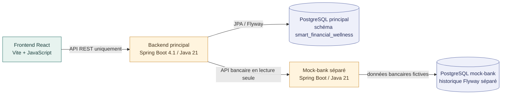

# Vue d'architecture démontrable

La plateforme principale et le fournisseur bancaire simulé restent deux
systèmes séparés. Le frontend ne contacte que le backend principal ; il ne lit
jamais directement une base de données et n'appelle jamais le mock-bank.

## Frontières de responsabilité

- Le frontend présente l'expérience utilisateur et remplacera progressivement
  ses fixtures par des appels au backend principal.
- Le backend porte les règles de bien-être financier et orchestre les accès à
  PostgreSQL, au mock-bank et, plus tard, au service d'inférence.
- Le mock-bank simule uniquement un fournisseur bancaire externe en lecture
  seule. Il ne contient aucune règle métier de bien-être financier.
- Les deux applications Spring Boot ont leurs propres données, leurs propres
  migrations Flyway et aucune clé étrangère entre leurs bases.

La page « Banque Démo » du prototype est une maquette visuelle du futur écran
de consentement. Elle ne réalise actuellement aucun appel au mock-bank.
