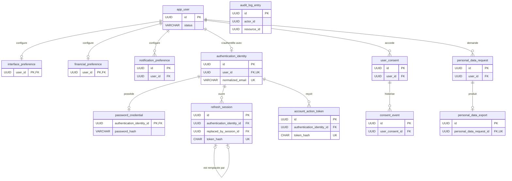
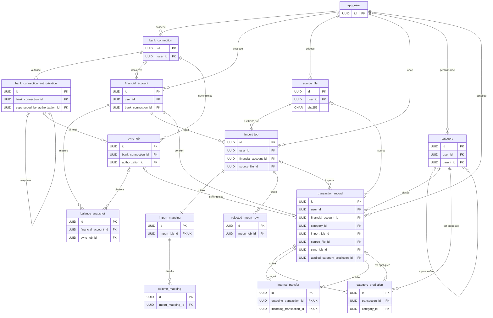
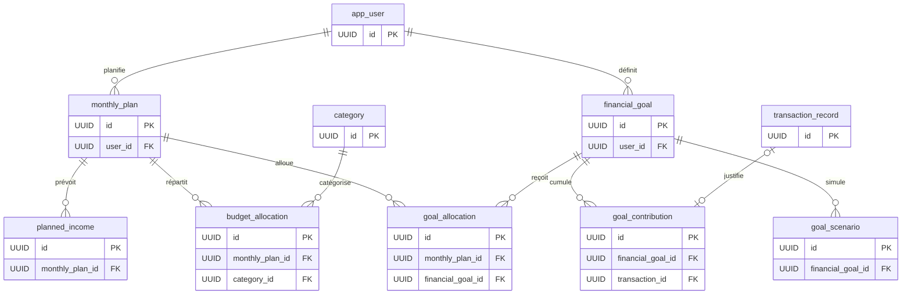
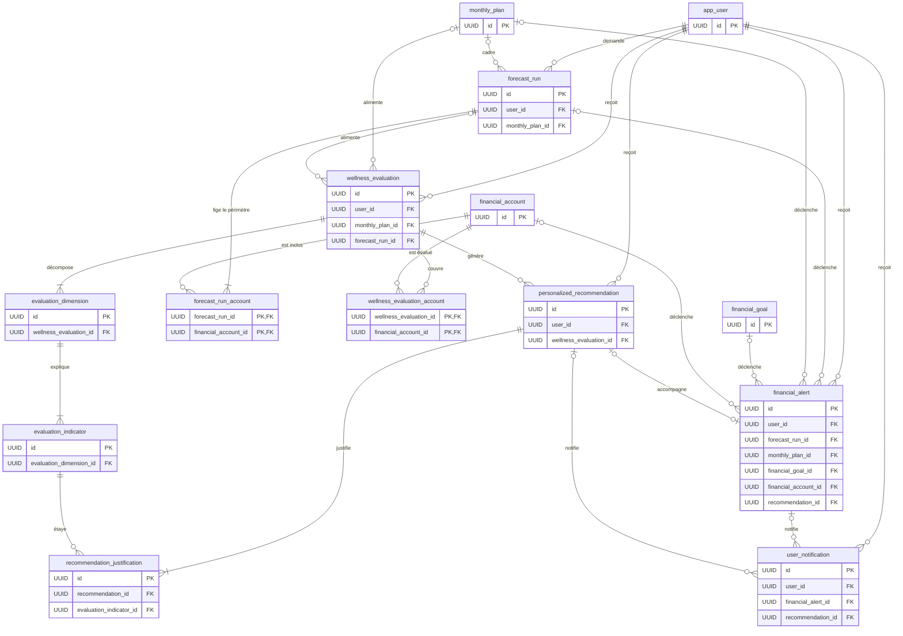

# Diagrammes de la base PostgreSQL

Ces vues Mermaid sont dérivées des migrations Flyway V1 à V10 présentes dans
`backend/src/main/resources/db/migration`. Elles privilégient les clés primaires,
les principales clés étrangères et les cardinalités utiles à une présentation.
Les colonnes techniques et les contraintes détaillées restent documentées dans
[le schéma Flyway](flyway-schema.md).

## A. Identité et sécurité

Cette vue regroupe l'identité métier, les préférences, l'authentification locale,
les consentements et les workflows liés aux données personnelles. Les mots de
passe et jetons sont représentés uniquement par leurs empreintes. Le journal
`audit_log_entry` conserve volontairement des identifiants sans clé étrangère
vers l'utilisateur afin de rester exploitable après un workflow de suppression.

## B. Données financières

La donnée canonique est `transaction_record`. Une transaction est manuelle,
issue d'un fichier ou issue d'une synchronisation bancaire, jamais plusieurs à
la fois. `source_file` identifie le fichier par SHA-256, tandis que les
autorisations bancaires ne conservent qu'une référence vers le gestionnaire de
secrets.

## C. Planification financière

Un plan mensuel décrit les revenus et enveloppes budgétaires. Sa capacité
d'épargne peut être allouée à plusieurs objectifs. Les contributions réelles
restent séparées des scénarios, qui servent uniquement à comparer des
hypothèses sans modifier le plan.

## D. Intelligence financière

Le périmètre d'une prévision est conservé dans `forecast_run_account`, même si
le calcul échoue. Une évaluation produite devient immuable et reste explicable
par ses dimensions et indicateurs. Les recommandations actives doivent avoir
au moins une justification reliée à un indicateur de la même évaluation.

## Lecture des cardinalités

- `||` : exactement un ;
- `o|` : zéro ou un ;
- `|{` : un ou plusieurs ;
- `o{` : zéro ou plusieurs.

Les triggers SQL complètent ces relations pour les invariants qui dépassent
une simple clé étrangère : cohérence utilisateur/devise, provenance des
transactions, virements internes, allocations, immutabilité des évaluations et
activation des recommandations.
