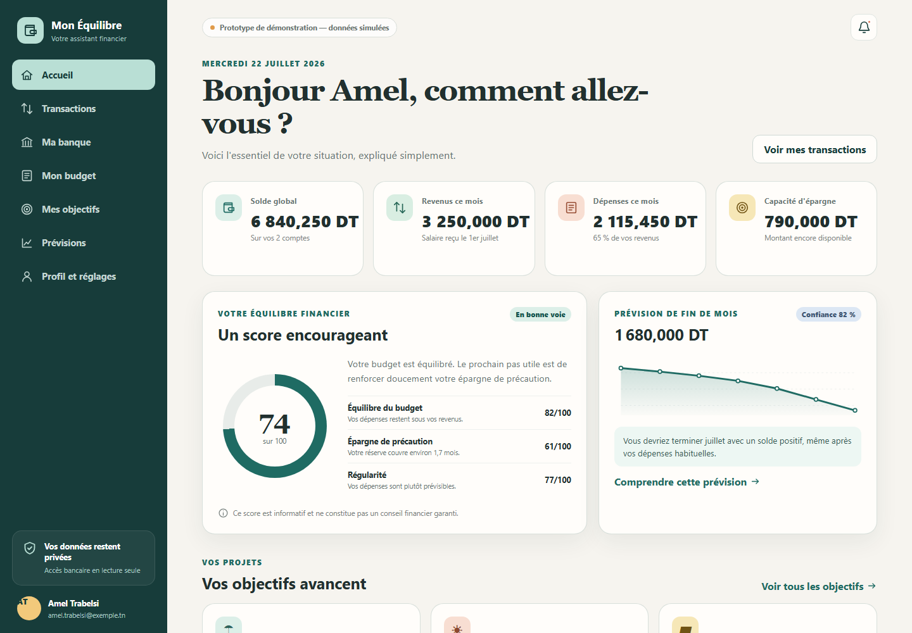
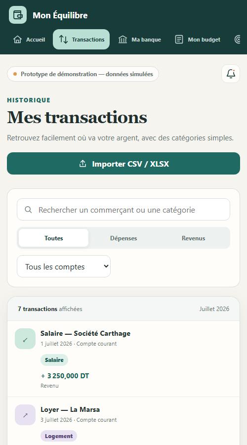
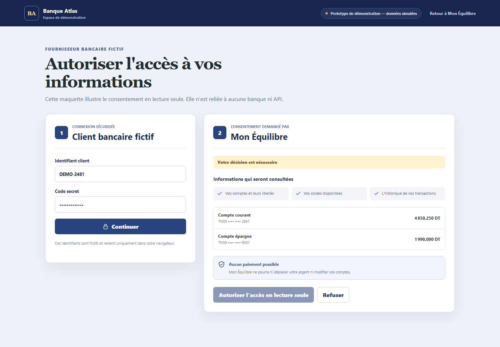

# Prototype UI de démonstration

Le dossier `frontend/` contient un prototype React/Vite entièrement en français.
Il illustre les parcours futurs sans appeler de backend et sans stocker de
donnée saisie. Toutes les informations financières visibles sont des fixtures
tunisiennes fictives centralisées dans `frontend/src/data/demoData.js`.

## Lancer la démonstration

Depuis la racine du dépôt :

```powershell
Set-Location frontend
npm install
npm run dev
```

Ouvrir ensuite <http://localhost:5173>. La page de connexion accepte n'importe
quelle valeur de démonstration et mène au tableau de bord.

Pour vérifier la compilation de production :

```powershell
npm run build
npm run preview
```

## Routes disponibles

| Route | Écran |
| --- | --- |
| `/connexion` | Connexion locale et accès au prototype |
| `/tableau-de-bord` | Synthèse, score expliqué, objectifs, prévision et recommandations |
| `/transactions` | Recherche, filtres et aperçu du mapping CSV/XLSX |
| `/connexion-bancaire` | Connexion en lecture seule, comptes et révocation |
| `/planification-salaire` | Salaire, dépenses, capacité d'épargne et répartition recommandée |
| `/objectifs` | Progression, allocations et comparaison de scénarios |
| `/previsions` | Prévision enregistrée et simulation temporaire |
| `/profil` | Profil, préférences, consentements, export et suppression |
| `/banque-demo` | Maquette visuelle distincte du futur consentement mock-bank |

La route `/` redirige vers `/connexion`. Une route inconnue revient également à
la connexion afin que la démonstration ne présente pas de page vide.

## Limites du prototype

- Aucun formulaire n'envoie de requête réseau.
- Les synchronisations, imports, exports, révocations et suppressions modifient
  uniquement un état local de démonstration.
- La maquette Banque Atlas ne constitue pas un frontend appelant directement le
  mock-bank : elle représente seulement le futur écran hébergé par ce service.
- Quand les API seront implémentées, le frontend principal appellera uniquement
  le backend Spring Boot conformément aux frontières d'architecture.
- Les recommandations et prévisions sont informatives et ne constituent pas un
  conseil financier garanti.

## Accessibilité et responsive

L'interface utilise des titres structurés, des libellés de formulaire, un lien
d'évitement, des états de focus visibles, des zones tactiles généreuses, des
statuts annoncés et une préférence `prefers-reduced-motion`. La navigation passe
en bandeau horizontal sur les petits écrans et les cartes deviennent une seule
colonne.

## Captures vérifiées

### Tableau de bord — desktop 1440 × 1000



### Transactions — vue étroite 500 × 900



### Consentement mock-bank — desktop 1440 × 1000


